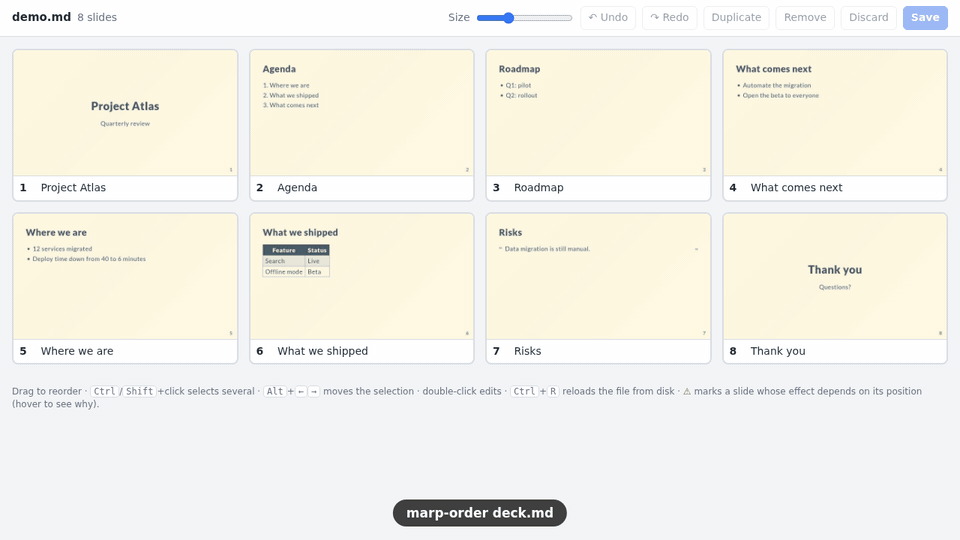
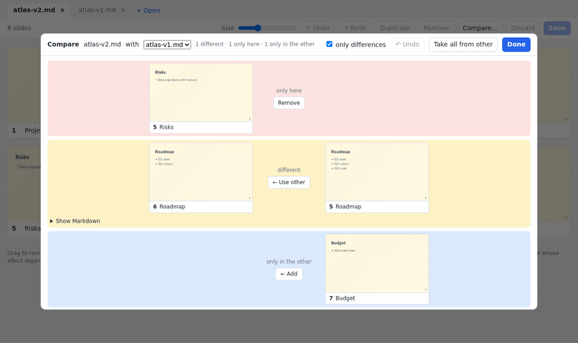

# marp-order

**English** · [Português](README.pt-BR.md)

Reorder the slides of a [Marp](https://marp.app) presentation by dragging thumbnails
around a grid, edit any slide with a live preview, and have the `.md` file rewritten
with the result.



Reordering a Marp deck by hand means cutting and pasting blocks of Markdown between
`---` lines without seeing the result. `marp-order` shows the whole deck at once, like
the "slide sorter" view of presentation software, and takes care of rewriting the file
without touching the content of the slides.

- **A single binary**, written in Rust; the interface runs in your browser on `localhost`.
- **Real thumbnails**, rendered by marp-cli with your presentation's theme.
- **Editor with live preview**: double-click opens the slide's Markdown and the result
  is redrawn as you type.
- **Several files in tabs**, with a list of recent files and the last session restored.
- **Compare and merge**: see which slides differ between two decks and copy them across.
- **No reformatting**: unedited slides are moved byte for byte; the front matter stays
  where it is.
- **Safe**: automatic backup, atomic writes and detection of external edits.
- **English and Portuguese** interface, switchable at any time.

## Requirements

| For | You need |
|---|---|
| Building from source | [Rust](https://rustup.rs) 1.80 or newer |
| Thumbnails and live preview (optional) | [marp-cli](https://github.com/marp-team/marp-cli) and Chrome, Chromium or Edge |

Without marp-cli the program still works, showing the text of each slide instead of a
thumbnail; the editor opens, but without the preview.

marp-order is developed and used on Linux. The macOS and Windows builds are compiled and
run through the automated tests on every change, but have not been tried by hand; please
open an issue if something misbehaves there.

## Installation

**Prebuilt binaries** for Linux, macOS and Windows are attached to each
[release](https://github.com/guiok/marp-order/releases): download the archive for your
system, unpack it and put `marp-order` somewhere on your PATH.

**From source**, with Rust installed:

```bash
cargo install --git https://github.com/guiok/marp-order
```

This installs the binary in `~/.cargo/bin`. Inside a clone of the repository,
`cargo install --path .` does the same and `make install` copies it to `~/.local/bin`.

For thumbnails:

```bash
npm install -g @marp-team/marp-cli
```

If `marp` is not on the PATH, the program falls back to `npx @marp-team/marp-cli`, which
downloads the package on first run.

## Usage

```bash
marp-order presentation.md            # one file
marp-order talk.md workshop.md        # each file in its own tab
marp-order                            # the files that were open last time
```

The browser opens with the grid. Rearrange, save with `Ctrl+S` and stop the program with
`Ctrl+C` in the terminal.

| Action | How |
|---|---|
| Reorder | drag the card (or several selected cards) |
| Select several | `Ctrl`+click, `Shift`+click, `Ctrl+A` |
| Move with the keyboard | `Alt+←` / `Alt+→`, `Alt+Home` / `Alt+End` |
| Duplicate / remove | `Ctrl+D` / `Delete` |
| Copy / cut / paste, also between tabs | `Ctrl+C` / `Ctrl+X` / `Ctrl+V` |
| Copy to another file | drag the cards onto its tab |
| Find slides by text | `Ctrl+F`, then `Enter` for the next match |
| Undo / redo | `Ctrl+Z` / `Ctrl+Y` |
| Edit the content | double-click |
| Discard changes | **Discard** button |
| Switch between English and Portuguese | **EN / PT** selector, top right |
| Save to the file | `Ctrl+S` |
| Reload the file from disk | `Ctrl+R` |
| Open another file | `Ctrl+O` or **+ Open** |
| Edit the front matter | **Front matter** button |
| Compare with another open file | **Compare…** button |

Each card shows its new position and, if the slide has moved, the position it has in the
file (`was 8`).

### Editing a slide

Double-clicking a card opens the editor: the slide's Markdown on the left, with syntax
colouring, and on the right the slide rendered by Marp with the deck's theme, images and
directives. The preview is redone on every change (a few hundred milliseconds).

Speaker notes (HTML comments that are not Marp directives) get their own box below the
text. If you change the text or the notes, the notes are written back as one comment at
the end of the slide.

| Action | How |
|---|---|
| Apply the edit | `Ctrl+Enter` or **Apply** |
| Apply and write the file | `Ctrl+S` |
| Cancel | `Esc` or **Cancel** |

Applying does not write the file: the edit stays pending, like a reordering, and can be
undone with `Ctrl+Z`. The card gets an **edited** tag, and its thumbnail is
re-rendered in the background a few seconds later. Writing `---` inside a slide splits it in two; the new slides
show up in the grid after saving.

The **Front matter** button opens the same editor on the YAML block at the top of the
file (theme, `paginate`, `headingDivider`…), with the first slide as preview. It applies
to the whole file, so it is written to disk as soon as you save it there, and it is only
available when the tab has no pending changes.

### Several files

Each file lives in a tab. **+ Open** (`Ctrl+O`) shows the recently opened files and a
folder browser limited to `.md` and `.markdown` files; **×** closes a tab. Unsaved
changes, the undo history and the selection are kept per tab while you switch, and a
dot on the tab marks unsaved changes. Slides can be copied between tabs with
`Ctrl+C`/`Ctrl+V` or by dragging them onto another tab, where they are added at the end.

The list of open files is remembered: running `marp-order` with no file reopens the tabs
of the last session. Recent files and the session are stored in
`~/.config/marp-order/` (or `$XDG_CONFIG_HOME/marp-order/`; `%APPDATA%\marp-order` on
Windows).

### Comparing and merging



With two or more files open, **Compare…** lines up the slides of the current tab with
those of another open file (as saved on disk) and marks each difference:

| Difference | What you can do |
|---|---|
| **different** – same title or mostly the same text | **← Use other** replaces your slide with the other one; *Show what differs* marks the changed lines |
| **only in the other** | **← Add** copies the slide into your file at that position |
| **only here** | **Remove** deletes it from your file |

**Take all from other** applies everything at once. Each action is a pending change in
the current tab, exactly like a manual edit: it can be undone, and nothing is written
until you save. The other file is never modified. A difference in the front matter
(theme, global directives) is shown but not merged: edit it with the **Front matter**
button.

When a slide comes from a file in another folder — through the comparison, pasting or
dragging — relative paths to images that exist there are rewritten (`img/a.png` becomes
`../other/img/a.png`), so the slide keeps pointing to the same files. Nothing is copied.

### Options

```
marp-order [options] [presentation.md ...] [-- marp-cli arguments]

  --port <n>         local server port (default: chosen by the system)
  --no-open          do not open the browser automatically
  --no-thumbs        do not render thumbnails (show only the slide text)
  --no-cache         do not keep thumbnails on disk between runs
  --marp-cmd <cmd>   marp-cli command (default: `marp` or `npx @marp-team/marp-cli`)
  -h, --help         show help
  -V, --version      show the version
```

Anything after `--` is passed on to marp-cli. Use it for custom themes:

```bash
marp-order talk.md -- --theme-set theme.css
```

The marp-cli command can also be set with the `MARP_ORDER_MARP_CMD` environment variable.

## What happens to your file

- **Front matter stays put.** The leading YAML block is never moved.
- **Slides are left intact.** The text of every unedited slide — including speaker notes
  and directives such as `<!-- _class: lead -->` — is copied byte for byte. Slides that
  remain neighbours keep even the spacing between them, so `git diff` shows only what
  changed.
- **Exact round trip.** Going back to the original order gives you the identical file.
- **Backup.** Before the first write of each run, the file is copied to
  `.marp-order-backups/presentation.md.<date>.bak` next to it. The ten most recent
  copies of each file are kept.
- **Atomic write.** The content goes to a temporary file that is then renamed, so a crash
  halfway through does not leave you with half a deck.
- **External edits.** If the file changes in your editor while marp-order is open, saving
  is blocked until you choose between reloading and overwriting. The same happens when
  the file was saved from another marp-order window.
- **Thumbnail cache.** The thumbnails of the last 40 decks are kept in
  `~/.cache/marp-order/` (`%LOCALAPPDATA%\marp-order` on Windows), so a file that has
  not changed shows its slides immediately when reopened. They are still re-rendered in
  the background, in case an image or the theme changed. `--no-cache` turns this off.
- **Cross-check with Marp.** Thumbnails are re-rendered on every save; if Marp sees a
  different number of slides than marp-order does, a warning is shown.

### The ⚠ warning

In Marp, a local directive written **without** `_` applies from the slide where it
appears to the end of the deck:

```markdown
<!-- paginate: true -->   ← this slide and all the following ones
<!-- _class: lead -->     ← this slide only
```

Moving a slide that has `paginate`, `class`, `header`, `footer`, `backgroundColor` and so
on changes which slides are affected. marp-order does not alter these directives; it
marks the card with ⚠ so you can check.

## Limitations

- **`headingDivider` and comments.** With `headingDivider`, Marp does not allow a comment
  before the heading of any slide but the first: it stays in the previous slide. If the
  first slide of the deck has such a comment and is moved, the comment changes slides.
  The card is marked with ⚠.
- **Encoding.** The file must be UTF-8.
- **Preview assets.** Images and fonts must be in the deck's folder or below it; paths
  with `../` or absolute paths do not show up in the editor (thumbnails and the final
  output are not affected).
- **Local use.** The server only accepts connections from `127.0.0.1` and has no
  authentication; it is not meant to be exposed on a network.
- **Preview port.** While the editor preview is in use, marp-cli's watch mode opens its
  own WebSocket server for reload notifications on the first free port from 37717 up,
  on all network interfaces. marp-cli has no option to change that. marp-order does not
  use it and no deck content goes through it.

## Development

```bash
make test     # parser, server and interface tests
make build    # release binary in target/release/
make                          # run it, reopening the last session
make run DECK=presentation.md
```

The code structure and the slide-splitting rules are described in
[docs/ARCHITECTURE.md](docs/ARCHITECTURE.md). Contributions are welcome:
when changing the parser, add a test to `src/deck.rs` and a case to
`slide_count_matches_marp_cli`, which compares the slide count with the real marp-cli
(`cargo test -- --ignored`). The same checks run on every push in GitHub Actions, on
Linux, macOS and Windows. Interface texts go through `t('…')`; a new one needs its
Portuguese entry in the `PT` table of `src/ui.html`.

## License

[MIT](LICENSE)
